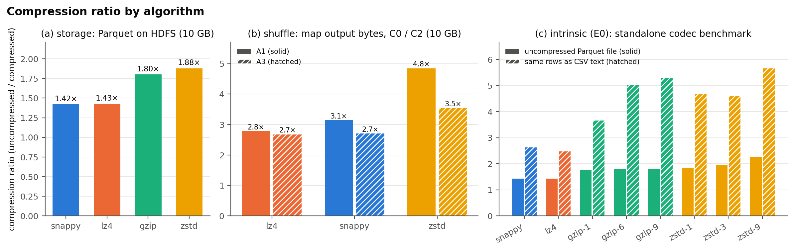
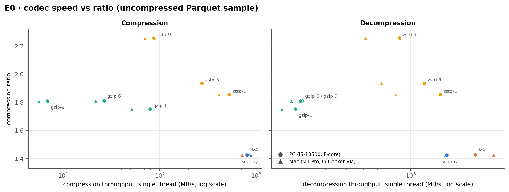
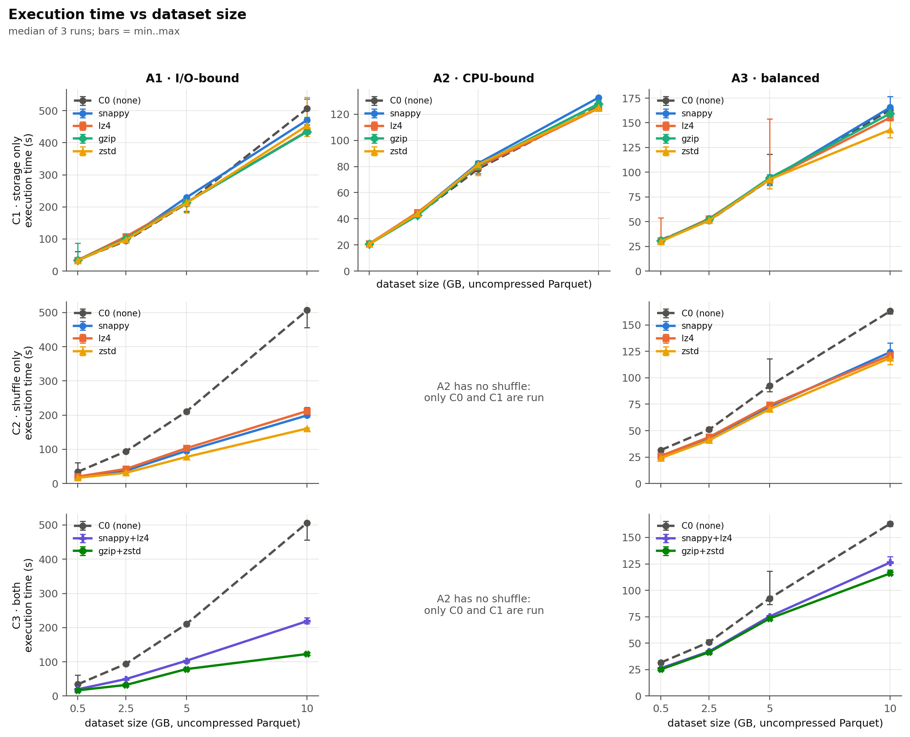
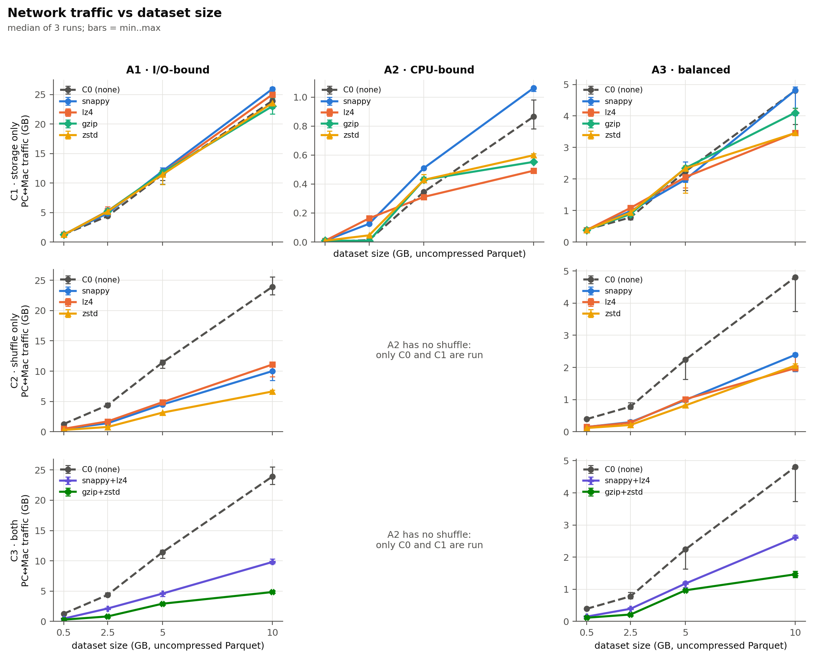
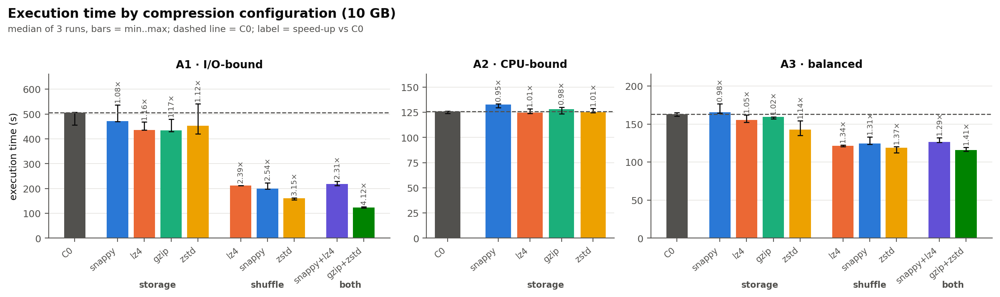
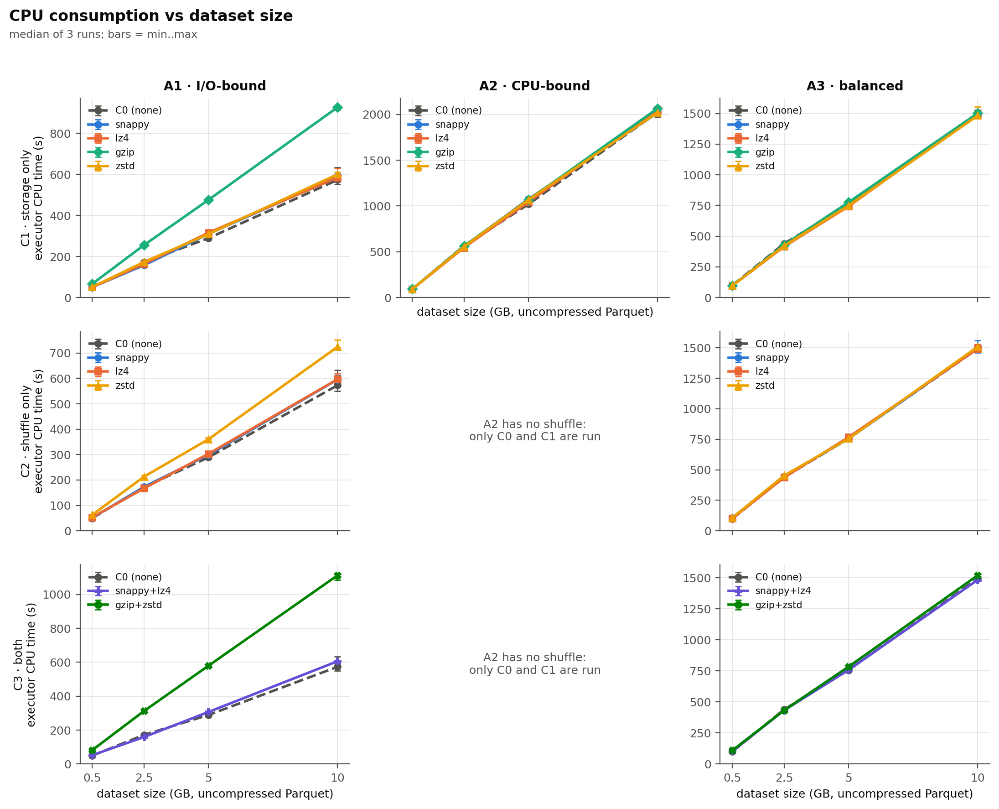
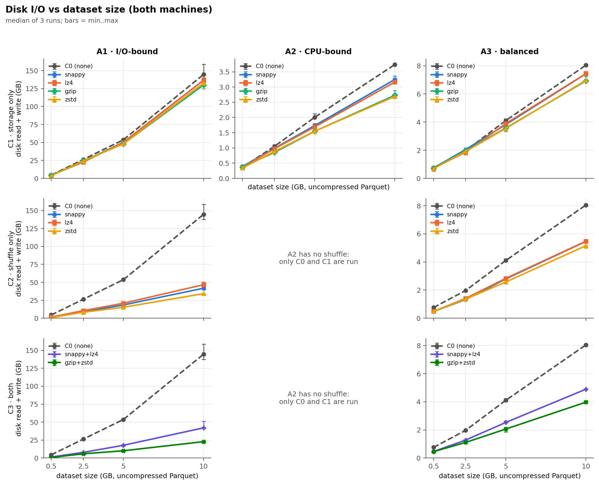
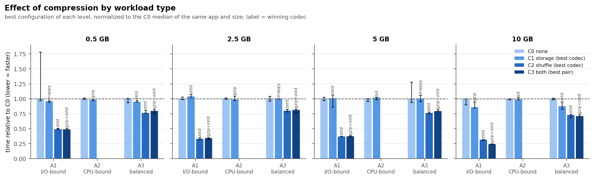
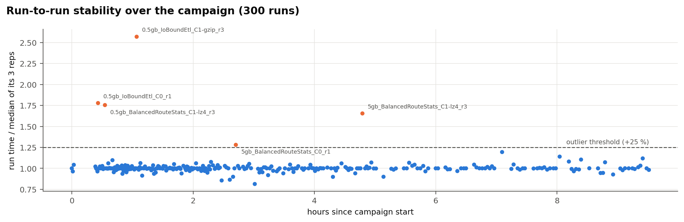

# Experimental Evaluation of Data Compression in Spark over HDFS

USTH InfraCloud project: technical report.
Repository layout: deployment in `docker/` and `deploy/`, applications in `spark-apps/`, experiment scripts in
`harness/`, raw measurements and figures in `results/`.

---

## 1. Objectives

Compression trades CPU time for fewer bytes on disk and on the network. This study measures when that trade pays
off in Apache Spark over HDFS, at two levels:

- **storage-level compression**: the Parquet files at rest in HDFS, read and written by the jobs;
- **communication-level compression**: the intermediate data exchanged between executors during the shuffle
  (plus spill and broadcast data).

We compare four codecs (snappy, LZ4, gzip, Zstandard) against an uncompressed baseline. The comparison covers
three workloads with different bottlenecks (I/O-bound, CPU-bound, balanced), four dataset sizes (0.5 to 10 GB)
and the four configurations C0–C3 required by the brief. Every configuration is repeated three times. We first
characterize the codecs in isolation (experiment E0), then in the cluster (300 Spark runs).

## 2. Experimental infrastructure

### 2.1 Hardware and network

| Machine | CPU | Memory | Role |
|---|---|---|---|
| PC (Linux, Ubuntu, kernel 6.8) | Intel i5-13500: 6 performance + 8 efficiency cores, 20 threads | 62 GB | NameNode, DataNode, Spark master, **4 Spark workers**, driver, monitoring |
| MacBook Pro (macOS, Docker Desktop) | Apple M1 Pro: 8 performance + 2 efficiency cores | 16 GB (Docker VM: 6 CPUs, 10 GB) | DataNode, **1 Spark worker** |

- **Network:** the two machines communicate over the home LAN; the Mac is on Wi-Fi. iperf3 with 4 streams,
  measured before every dataset size during the campaign: Mac→PC **310–349 Mbit/s**, PC→Mac **550–670 Mbit/s**.
  This slow, asymmetric link is the cluster's scarcest resource and drives several results.
- **Disks:** local NVMe on both machines. On the Mac, HDFS and shuffle data live inside the Docker Desktop VM's
  virtual disk.

### 2.2 Software and deployment

Everything runs in Docker, from one multi-architecture image (`docker/Dockerfile`, amd64 + arm64):
eclipse-temurin 17, **Hadoop 3.4.3** (HDFS) and **Spark 4.0.5** (Scala 2.13), with pinned SHA-512 checksums. The
PC and the Mac each run a Compose file (`deploy/compose.pc.yml`, `deploy/compose.mac.yml`).

- **Networking:** every container uses the host's network (`network_mode: host`), so PC↔Mac traffic is plain LAN
  traffic. We tried a Tailscale overlay first and abandoned it: its throughput swung between 38 and 285 Mbit/s
  while the raw LAN held ~300 Mbit/s, which would have added unexplained variance to every run.
- **HDFS:** one NameNode, two DataNodes (one per machine), replication factor 1, 128 MB blocks.
- **Spark standalone:** five identical workers, four on the PC and one on the Mac. Each runs one executor with
  4 cores and a 5 GB heap, so the cluster has **20 cores**. Spark standalone cannot size executors per worker,
  so the larger machine is expressed as more identical workers. Each PC worker container is capped at 4 CPUs.
  The driver runs in a client container on the PC.

### 2.3 Fixed baseline (reproducibility)

All runs share one configuration file (`docker/conf/spark-defaults.conf`). Compression settings are never in that
file or in code: the experiment runner passes them per run with `--conf`, so configurations differ only in those
flags. Settings that would make Spark's behaviour depend on data sizes are disabled:

- adaptive query execution off;
- `spark.sql.shuffle.partitions` = 64;
- broadcast joins off;
- speculation off;
- dynamic allocation off.

Shuffle and spill files go to a dedicated volume, so their disk I/O is visible to monitoring.

### 2.4 Monitoring and metrics

- **Prometheus** scrapes **node-exporter** (CPU, disk, network) and **cAdvisor** (per container) on both machines
  every 2 s; **Grafana** provides the dashboards.
- **Spark event logs** give per-task CPU time, GC time, shuffle bytes, fetch wait time and stage durations.

For every run the runner records the metrics below in `results/raw/<run>/result.json`:

| Metric | Source |
|---|---|
| Execution time | Wall-clock time of `spark-submit` |
| CPU consumption | Sum of executor task CPU time (event log) and mean busy cores per machine (node-exporter) |
| Disk I/O volume | Bytes read + written on both machines (node-exporter) |
| Network traffic | Bytes received + sent on the PC's LAN interface (node-exporter) |
| Compressed size | HDFS size of the input dataset and of the job output (WebHDFS) |
| Shuffle | Map-output bytes, remote-read bytes, fetch wait, wall time of the shuffle-map stages (event log) |

Two measurement limits:

- **Network** is counted only on the PC's interface, which carries every byte crossing the LAN. The Mac VM's
  counters miss flows the PC initiates, so they are unreliable.
- **Per-container CPU is not available on the Mac** (cAdvisor cannot see containers under Docker Desktop), so
  per-machine CPU comes from node-exporter and the event log.

"Link airtime" approximates how busy the half-duplex Wi-Fi link was: Mac→PC rate / 280 Mbit/s + PC→Mac rate /
535 Mbit/s. The reference capacities were measured during the earlier characterization runs, and capacity was
slightly higher during the campaign, so values just above 100 % mean the link was saturated.

## 3. Dataset

- **Source:** NYC TLC yellow taxi trip records, July 2016 to December 2024: 102 monthly Parquet files, 8 GB as
  downloaded (`harness/download_tlc.py`). From July 2016 the files have pickup and drop-off zone IDs, which A3
  needs.
- **Ingest** (`prepare/Ingest.scala`) normalizes the schemas, which drift over the years, into 18 typed columns:
  - filters out invalid trips;
  - derives the trip duration, pickup hour and pickup date;
  - result: **525.6 M rows, 18.25 GB** of uncompressed Parquet.
- **Materialize** (`prepare/Materialize.scala`) draws nested, deterministic samples of 0.5, 2.5, 5 and 10 GB of
  uncompressed Parquet, by hashing each row (xxhash64). It writes each sample once per storage codec, so all
  codecs hold exactly the same rows. File count = max(8, size / 128 MB).

| Size | Rows | uncompressed | snappy | lz4 | gzip | zstd |
|---|---|---|---|---|---|---|
| 0.5 GB | 14.4 M | 523 MB | 372 MB | 370 MB | 293 MB | 279 MB |
| 2.5 GB | 72.0 M | 2.62 GB | 1.85 GB | 1.84 GB | 1.46 GB | 1.40 GB |
| 5 GB | 144.0 M | 5.25 GB | 3.69 GB | 3.68 GB | 2.91 GB | 2.79 GB |
| 10 GB | 288.0 M | 10.50 GB | 7.39 GB | 7.36 GB | 5.83 GB | 5.59 GB |

The 20× range of sizes (0.5–10 GB) replaces the suggested 1–20 GB. It halves the campaign time (10 h instead of
~20 h), and the largest size is still where the cluster's behaviour changes (Section 7.5).

## 4. Applications and workload characterization

Three Spark/Scala applications (`spark-apps/src/main/scala/compbench/apps/`), all reading the same Parquet dataset:

| App | What it does | Designed bottleneck |
|---|---|---|
| **A1** `IoBoundEtl` | Repartitions every row by pickup date (a full shuffle of all columns) and writes the result back to HDFS | Moving data: shuffle and network |
| **A2** `CpuBoundKMeans` | One K-means assignment pass, k = 1024, over 8 numeric features: distances to 1,024 fixed centroids for every row; per-partition sums are reduced on the driver; no shuffle | Computation |
| **A3** `BalancedRouteStats` | Derives speed, fare per mile and tip percentage, then groups by (pickup zone, drop-off zone, part of day) and computes count, mean, stddev, skewness and kurtosis of 7 columns; sorts and writes ~30 MB | Both |

Development history:

- **A2:** k was raised from 512 to 1024 to make A2 unambiguously CPU-bound.
- **A3:** went through five versions. An early version joined its aggregates back to the trips, which saturated
  the Wi-Fi link (I/O-bound, not balanced). The size of the group-by key turned out to control A3's shuffle
  volume, and the final version sits between the other two apps.

**Characterization** (configuration C0, median of 3 runs). CPU utilization = executor task CPU time / (wall time
× 20 cores):

| App | Size | Time | CPU utilization | Busy cores PC / Mac | Link airtime | Network | Shuffle |
|---|---|---|---|---|---|---|---|
| A1 | 5 GB | 210 s | 7 % | 2.2 / 1.1 | **107 %** | 11.4 GB | 22.5 GB |
| A1 | 10 GB | 506 s | 6 % | 2.1 / 1.2 | **102 %** | 23.9 GB | 44.9 GB |
| A2 | 5 GB | 78 s | **65 %** | 11.0 / 2.7 | 13 % | 0.3 GB | 0 |
| A2 | 10 GB | 126 s | **80 %** | 12.9 / 3.3 | 19 % | 0.9 GB | 0 |
| A3 | 5 GB | 92 s | 41 % | 7.7 / 2.1 | 47 % | 2.2 GB | 2.1 GB |
| A3 | 10 GB | 163 s | 46 % | 8.1 / 2.3 | 61 % | 4.8 GB | 4.1 GB |

- **A1 is I/O-bound.** The executors are idle more than 90 % of the time while the Wi-Fi link is saturated
  (airtime ≥ 97 % from 2.5 GB). Its shuffle is 4.3× its input because it moves every column of every row.
- **A2 is CPU-bound.** 65–80 % of all 20 cores are busy and the network is almost unused. At 0.5 GB its
  utilization is lower (22 %) because ~10 s of fixed Spark start-up dominates a 21 s run.
- **A3 is balanced.** About 40–46 % CPU and 47–61 % link airtime; neither resource is saturated.

## 5. Compression configurations

| Config | Storage (Parquet codec, read and write) | Communication (shuffle, spill, broadcast) | Variants |
|---|---|---|---|
| C0 | none | off | 1 |
| C1 | snappy, lz4, gzip, zstd | off | 4 |
| C2 | none | lz4, snappy, zstd | 3 |
| C3 | snappy + lz4 ("fast pair"), gzip + zstd ("heavy pair") | | 2 |

- **Storage settings:** `spark.sql.parquet.compression.codec`, with Parquet's defaults: gzip level 6, zstd level
  3. Parquet `lz4` is the Hadoop LZ4 codec. The newer `lz4_raw` was dropped because its pure-Java decoder fails on
  the ARM64 Mac executor (`MalformedInputException`).
- **Communication settings:** `spark.shuffle.compress`, `spark.shuffle.spill.compress`,
  `spark.broadcast.compress` and `spark.io.compression.codec`, with Spark's default zstd level 1. Spark offers no
  gzip codec for the shuffle, which is why C2 has three variants.
- **A2 runs only C0 and C1,** because it has no shuffle.
- That gives 10 + 5 + 10 = **25 app-configurations**, × 4 sizes × 3 repetitions = **300 runs**.

## 6. Methodology

- **Per run** (`harness/runner.py`):
  1. check that all 5 workers and both monitoring targets are alive and reporting fresh samples;
  2. delete the previous output;
  3. drop the OS page cache on both machines;
  4. `spark-submit`;
  5. wait for the last Prometheus scrape and collect the metrics;
  6. delete the output.
- **Order:** sizes run from smallest to largest; within a size, the 75 runs are shuffled with a fixed seed. This
  stops slow drift, such as Wi-Fi conditions or thermals, from lining up with a configuration.
- **Network check:** an iperf3 measurement precedes each size.
- **Repetitions and statistics:** each configuration runs 3 times.
  - Figures show the **median**, with error bars spanning **min..max**.
  - Two configurations are called significantly different when their min..max ranges do not overlap.
  - The median is used because a few runs were hit by Mac stalls (Section 9).
- **Campaign:** 300 runs in ~9.5 h overnight, with no failure and no retry. Median coefficient of variation of
  execution time over the 100 configurations: **2.5 %**.
- **E0 (intrinsic codec benchmark):** `codec-bench`, a single-threaded JVM benchmark run on both machines. It uses
  the same libraries Spark uses: snappy-java, lz4-java, zstd-jni and java.util.zip.
  - It compresses and decompresses an in-memory 134 MB uncompressed Parquet file and 256 MB of the same rows as
    CSV text.
  - 5 repetitions, after a warm-up that verifies the round trip.
  - On the PC it is pinned to a performance core.
  - It reports ratio, MB/s, and CPU seconds per GB.

## 7. Results

### 7.1 Intrinsic codec characteristics (E0)





| Codec (PC, Parquet sample) | Ratio | Compress MB/s | Decompress MB/s | Compress CPU s/GB | Decompress CPU s/GB |
|---|---|---|---|---|---|
| snappy | 1.43 | 802 | 1,475 | 1.1 | 0.6 |
| lz4 | 1.43 | 825 | 2,004 | 1.2 | 0.4 |
| zstd-1 | 1.85 | 524 | 1,373 | 1.9 | 0.7 |
| zstd-3 | 1.94 | 274 | 1,156 | 3.7 | 0.9 |
| zstd-9 | 2.26 | 87 | 886 | 11.8 | 1.1 |
| gzip-1 | 1.75 | 80 | 289 | 12.8 | 3.5 |
| gzip-6 | 1.81 | 26 | 310 | 38.5 | 3.3 |
| gzip-9 | 1.81 | 7 | 305 | 149.1 | 3.3 |

- **Three tiers.** snappy and lz4 are fastest with the lowest ratio. zstd is 2–4× slower to compress but reaches
  a much higher ratio. gzip is the slowest at every level.
- **zstd beats gzip outright.** zstd-3 beats gzip-6 on ratio (1.94 vs 1.81), compression speed (10×) and
  decompression speed (4×). On already-encoded Parquet, gzip-9 gains nothing over gzip-6 at 4× the cost.
- **Format matters as much as the codec.** The same rows as CSV text compress 2.5–5.7×, against 1.4–2.3× for
  the Parquet file, because Parquet is already dictionary- and run-length-encoded.
- **The machines are comparable.** The M1 Pro (in the Docker VM) is within ±20 % of the i5 performance core on
  compression, except gzip-1 (−36 %). It is faster at lz4 decompression and slower at zstd and gzip
  decompression (−10 to −40 %).
- **E0 predicts in-cluster ratios well.** Storage ratios measured on HDFS match E0's Parquet ratios within 3 %.

### 7.2 Storage-level compression (C1)



At 10 GB, storage compression alone (first row of fig1; fig6). **Bold** times are significantly different from C0.
A1's C0 runs spread from 455 to 507 s, so none of A1's storage-only gains is significant.

| 10 GB, storage only | Input read | A1 time | A1 CPU | A1 disk R + W | A3 time | A2 time |
|---|---|---|---|---|---|---|
| none (C0) | 10.50 GB | 506 s | 573 s | 145 GB | 163 s | 126 s |
| snappy | 7.39 GB | 471 s (1.08×) | 589 s | 136 GB | 166 s (0.98×) | **133 s (0.95×)** |
| lz4 | 7.36 GB | 436 s (1.16×) | 585 s | 136 GB | 155 s (1.05×) | 125 s (1.01×) |
| gzip | 5.83 GB | 434 s (1.17×) | 926 s (+62 %) | 130 GB | **159 s (1.02×)** | 128 s (0.98×) |
| zstd | 5.59 GB | 453 s (1.12×) | 600 s | 132 GB | **143 s (1.14×)** | 125 s (1.01×) |

- **Dataset size:** compression shrinks the stored data by 30 % (snappy, lz4) to 47 % (zstd).
- **Overhead:** decompressing the input costs little CPU except with gzip (+62 % for A1). Writing A1's compressed
  output is included in that figure.
- **Disk I/O:** storage compression cuts input reads but hardly changes A1's total disk volume, which is dominated
  by its 45 GB shuffle being written and read back (93 GB of the 145 GB are writes). Disk throughput stays at
  ~290 MB/s whatever the codec.
- **Does the saved disk I/O compensate for the CPU cost?** Only when the input read is on the critical path.
  Below 10 GB it is not: most tasks read node-local NVMe blocks, and all four codecs were significantly *slower*
  for A1 at 2.5 GB.
- **At 10 GB there is a trend, not a significant result, for A1.** The end-to-end speed-ups (1.08–1.17×) all
  overlap C0's wide 455–507 s range. Two measurements suggest the trend is real:
  - the read-heavy map stage is significantly shorter with lz4, gzip and zstd (49–59 s vs 81–86 s for C0);
  - with shuffle compression on, adding gzip storage is significantly faster (C3 vs C2, Section 7.4).

  A3 is significantly faster end to end with zstd (1.14×) and, marginally, with gzip (1.02×). A2 with snappy is
  significantly slower (0.95×, Q3).

### 7.3 Communication-level compression (C2)



| 10 GB | Time | Speed-up | Shuffle written | PC↔Mac traffic | Avg. throughput | Fetch wait (sum) | Shuffle-map stage | Executor CPU |
|---|---|---|---|---|---|---|---|---|
| A1 C0 | 506 s | — | 44.9 GB | 23.9 GB | 47 MB/s | 7,396 s | 85 s | 573 s |
| A1 lz4 | 212 s | 2.39× | 16.1 GB | 11.1 GB | 52 MB/s | 1,999 s | 75 s | 597 s (+4 %) |
| A1 snappy | 199 s | 2.54× | 14.3 GB | 10.0 GB | 50 MB/s | 1,752 s | 74 s | 596 s (+4 %) |
| A1 zstd | 161 s | **3.15×** | 9.3 GB | 6.6 GB | 41 MB/s | 848 s | 79 s | 724 s (+26 %) |
| A3 C0 | 163 s | — | 4.1 GB | 4.8 GB | 30 MB/s | 999 s | 124 s | 1,493 s |
| A3 lz4 | 121 s | 1.34× | 1.5 GB | 2.0 GB | 16 MB/s | 288 s | 103 s | 1,493 s |
| A3 zstd | 119 s | **1.37×** | 1.2 GB | 2.1 GB | 17 MB/s | 215 s | 101 s | 1,509 s |

- **Ratios are high:** 2.7–3.5× (A3) and 2.8–4.8× (A1), because shuffle blocks are row-format data.
- **The link stays saturated for A1.** PC-side throughput is ~40–55 MB/s whatever the codec. Compression
  doesn't make the link faster; it removes up to 72–82 % of the bytes.
- **Waiting collapses:** reducers' fetch-wait time falls 9× for A1 with zstd.
- **The CPU overhead is small.** lz4 and snappy add 4 %. zstd adds 26 % on A1 and nothing measurable on A3,
  whose CPU is dominated by its aggregation.
- **Never counterproductive here:** all 3 codecs × 2 applications × 4 sizes are significantly faster than C0.

### 7.4 Combined compression (C3) and configuration comparison



Figures for the other sizes: `results/plots/fig6_time_vs_config_{0.5,2.5,5}gb.png`.

- **Below 10 GB, C3 ≈ C2:** within ±4 % of the matching shuffle-only configuration, apart from one significant
  16 % slow-down (A1 snappy+lz4 at 2.5 GB).
- **At 10 GB the heavy pair adds up for A1:** gzip+zstd **4.12×** vs 3.15× for zstd shuffle alone. The fast pair
  never beats lz4 shuffle-only.
- **CPU cost:** the heavy pair costs 1.65–2.0× A1's C0 CPU (fig2).

### 7.5 Impact of dataset size





- **Ratios don't depend on size,** and neither does the shuffle codec ranking (zstd > snappy > lz4 for A1 and A3
  at all sizes).
- **Speed-ups grow with size.** Fixed start-up costs dilute them at 0.5 GB, and the absolute savings grow linearly
  with size.
- **Something changes between 5 and 10 GB.** The data doubles, but the Mac's disk reads during A1/C0 grow 6×
  (4.6 → 28.1 GB) and A1's time per GB rises from 42 to 51 s. That points to the Mac VM's 10 GB of memory no
  longer holding the working set; this interpretation is inferred from the counters.
- **Consequence at 10 GB:** storage compression begins to matter.
  - A3 with zstd storage is significantly faster (1.14×).
  - A1's map stage is significantly shorter (81–86 s → 49–59 s with lz4, gzip or zstd).
  - C3 pulls ahead of C2 for A1 (significant).

  A1's end-to-end storage-only gain is only a trend (1.08–1.17×, within C0's run-to-run spread).

### 7.6 Impact of workload type



Best configuration of each level relative to C0:

| | A1 I/O-bound | A2 CPU-bound | A3 balanced |
|---|---|---|---|
| Speed-up range | up to 4.1× | ±5 %, never significantly faster | up to 1.4× |
| What drives it | shuffle bytes over the saturated link | nothing to save: neither disk nor network is the bottleneck | shuffle bytes; link ~50 % busy |

The benefit follows how much of the run is spent waiting for the bytes that compression removes.

## 8. Analysis (Q1–Q7)

Unless noted, numbers are medians of 3 runs. "Significant" means the min..max ranges do not overlap. Speed-up = C0 time / configuration time.

### Q1. Which algorithms give the best trade-off between compression ratio and CPU overhead?

**zstd, at both levels.** It has the best ratio among the fast codecs and costs much less CPU than gzip. gzip is
dominated by zstd everywhere; snappy and lz4 are the cheapest but compress least.

| | snappy | lz4 | gzip | zstd |
|---|---|---|---|---|
| E0 ratio, Parquet sample | 1.43 | 1.43 | 1.81 (level 6) | 1.94 (level 3) |
| E0 compression speed, 1 core, PC (MB/s) | 802 | 825 | 26 | 274 |
| E0 compression CPU (s per GB) | 1.1 | 1.2 | 38.5 | 3.7 |
| Storage ratio on HDFS (10 GB) | 1.42 | 1.43 | 1.80 | 1.88 |
| A1 extra executor CPU vs C0, storage (10 GB) | +3 % | +2 % | **+62 %** | +5 % |
| Shuffle ratio, A1 (10 GB) | 3.1 | 2.8 | n/a | **4.8** |
| A1 extra executor CPU vs C0, shuffle (10 GB) | +4 % | +4 % | n/a | +26 % |
| A1 speed-up, shuffle only (10 GB) | 2.54× | 2.39× | n/a | **3.15×** |

- **zstd** gives the highest ratio at both levels and the best time at both levels. Its CPU cost (+5 % storage,
  +26 % shuffle on A1) is repaid many times by the traffic it removes.
- **gzip** is 10× slower than zstd-3 at compressing and compresses less (E0: 26 vs 274 MB/s, ratio 1.81 vs 1.94).
  Higher gzip levels gain almost nothing on Parquet: gzip-9 is 4× slower than gzip-6 for the same 1.81× (fig8).
- **snappy / lz4** are nearly free in CPU (+2–4 %) but save the least. They are the right choice only when CPU,
  not I/O, is scarce.
- The ratios measured inside Spark match E0 within 3 %. The intrinsic benchmark therefore predicts in-situ
  compression well; what it cannot predict is whether the saved bytes were on the critical path (Q2–Q5).

### Q2. Does compression systematically improve I/O-bound applications?

**No. Shuffle compression does, storage compression does not** (A1, figs 1, 6, 7).

- **Shuffle compression (C2): every codec at every size is significantly faster**, from 1.67× (lz4, 0.5 GB) to
  3.15× (zstd, 10 GB). A1 is limited by the Wi-Fi link: the link is ~100 % busy under C0 from 2.5 GB upward. Its
  shuffle is 4.3× its input (45 GB at 10 GB). Compression cuts PC↔Mac traffic from 23.9 GB to 6.6 GB (zstd), and
  the summed shuffle fetch-wait time from 7,396 s to 848 s.
- **Storage compression (C1) is not systematic:**

  | A1, storage only | 0.5 GB | 2.5 GB | 5 GB | 10 GB |
  |---|---|---|---|---|
  | snappy | 1.04 | **0.95** | 0.92 | 1.08 |
  | lz4 | 1.01 | **0.88** | 0.98 | 1.16 |
  | gzip | 1.01 | **0.94** | 0.98 | 1.17 |
  | zstd | 1.03 | **0.96** | 0.99 | 1.12 |

  (bold = significantly slower than C0; the 10 GB gains are not significant: they overlap C0's 455–507 s spread)

  Storage compression only shrinks the input read, and 91 % of A1's tasks read from their own machine's NVMe disk, which
  is not A1's bottleneck. It does **not** shrink the shuffle (45 GB under every C1 codec), so the saturated link is
  untouched. At 10 GB a gain appears, but only as a trend: the read stage is significantly shorter, while
  end-to-end times stay within run-to-run variation (Q4).
- So "I/O-bound" is not enough to predict a benefit. Compression helps when it shrinks the bytes on the
  bottleneck resource.

### Q3. How does compression affect CPU-bound applications?

**It has no measurable benefit and a small cost** (A2, figs 2, 6, 7).

- Every A2 configuration is within ±5 % of C0 at every size. The only significant differences are slow-downs
  (4 of 16 cases): snappy storage is 5 % slower at 5 GB and 10 GB, gzip 4 % slower at 5 GB, and lz4 4 % slower
  at 2.5 GB.
- Executor CPU rises 0–5 %. That matches the E0 decompression costs: reading 10.5 GB adds 6 s (snappy) to 39 s
  (gzip) of CPU, against ~2,020 s of K-means CPU, so at most 2 %.
- Storage compression still cuts A2's input bytes (10.5 → 5.6 GB with zstd) and disk reads (3.7 → 2.6 GB). That
  saving does not translate into time because A2 keeps the PC's cores ~80 % busy (12.9 of 16 at 10 GB) and moves
  almost nothing over the network (link 13–19 % busy). There is no idle I/O time for compression to recover.
- A2 has no shuffle, so communication compression is not applicable (only C0 and C1 were run).

### Q4. How do the benefits evolve with increasing dataset size?

**They grow with size, for two reasons. The algorithm ranking does not change.**

| best speed-up vs C0 | 0.5 GB | 2.5 GB | 5 GB | 10 GB |
|---|---|---|---|---|
| A1, shuffle zstd (C2) | 2.02× | 3.00× | 2.71× | 3.15× |
| A1, gzip + zstd (C3) | 2.05× | 2.90× | 2.67× | **4.12×** |
| A3, shuffle zstd (C2) | 1.31× | 1.25× | 1.31× | 1.37× |
| A3, gzip + zstd (C3) | 1.25× | 1.23× | 1.26× | 1.41× |
| A3, storage zstd (C1) | 1.05× | 1.00× | 0.99× | **1.14×** |

1. **Fixed costs dilute the benefit at small sizes.** A 0.5 GB run includes ~10–15 s of Spark start-up and
   scheduling that compression cannot shorten. A1's C0 time is 68 s/GB at 0.5 GB against 38–51 s/GB above that.
2. **At 10 GB, I/O becomes a limit on the Mac as well, so storage compression begins to matter.** From 5 GB
   to 10 GB the data doubles, but the Mac's disk reads during A1/C0 grow 6× (4.6 → 28.1 GB) and its writes 2.7×.
   That is consistent with the Mac VM's 10 GB of memory no longer holding the working set (shuffle files and
   input), so data is re-read from its virtual disk instead of from memory. This interpretation is inferred from
   the counters, not measured directly. In that regime:
   - storage compression significantly shortens A1's map stage (81–86 s → 49–59 s with lz4, gzip or zstd);
   - A3's storage-only zstd goes from no effect to a significant 1.14×;
   - combined compression (C3) pulls significantly ahead of shuffle-only (C2) for A1: 123 s vs 161 s.

   For A1 with storage compression alone, the end-to-end gain (1.08–1.17×) is a trend only: it lies inside
   C0's wide 455–507 s range. More repetitions would be needed to confirm it.
- **The relative order of the algorithms is stable.**
  - Ratios do not depend on size: storage 1.42 / 1.43 / 1.80 / 1.88 at every size; shuffle within ±2 %.
  - The shuffle ranking zstd > snappy > lz4 holds for A1 and A3 at all four sizes.
  - Among storage codecs, the differences below 10 GB are within run-to-run variation, so no ranking is claimed.
- Absolute savings grow linearly with size: A1's network traffic is 1.3 / 4.4 / 11.4 / 23.9 GB under C0, and
  zstd shuffle removes 72–82 % of it at every size.

### Q5. Is compression more beneficial for storage or for network communication?

**For network communication, by a wide margin** (figs 4, 5, 6).

| 10 GB | best storage only (C1) | best shuffle only (C2) |
|---|---|---|
| A1 | 1.17× (gzip, not significant) | **3.15×** (zstd) |
| A3 | 1.14× (zstd) | **1.37×** (zstd) |

C2 beats C1 at every size for both shuffle-heavy apps. Three measured reasons:

1. **Volume.** A1's shuffle (45 GB) is 4.3× its input (10.5 GB), so there are more bytes to save.
2. **Compressibility.** The same codec compresses Spark's row-format shuffle data 2.7–4.8× but columnar Parquet
   only 1.4–1.9×, because Parquet is already dictionary- and run-length-encoded. E0 shows the same gap: the same
   rows as CSV text compress 2.5–5.7× against 1.4–2.3× for the Parquet file (fig5c).
3. **Where the bottleneck is.** The shuffle crosses the Wi-Fi link, which runs at its ceiling: PC-side throughput
   stays at 40–55 MB/s whatever the codec. Compression does not raise that throughput, it removes bytes (23.9 →
   6.6 GB). Storage reads are mostly local NVMe reads, which were not limiting below 10 GB and only partly
   limiting at 10 GB (Q4).

Shuffle compression was never counterproductive here: all 3 codecs × 2 apps × 4 sizes are significantly faster.
Caveat: this is a slow-network cluster. The shuffle advantage should shrink on a fast LAN, but we did not measure
that (see Q7).

### Q6. Can combining storage and communication compression degrade performance?

**Yes, mildly, when the storage half has nothing to save. When it does, the effects add up** (fig6, C3 vs C2).

| C3 time / C2 time with the same shuffle codec | 0.5 GB | 2.5 GB | 5 GB | 10 GB |
|---|---|---|---|---|
| A1: snappy+lz4 vs lz4 | 0.97 | **1.16** (slower) | 1.00 | 1.03 |
| A1: gzip+zstd vs zstd | 0.99 | 1.03 | 1.01 | **0.76** (faster) |
| A3: snappy+lz4 vs lz4 | 1.01 | 0.96 | 1.01 | **1.04** (slower) |
| A3: gzip+zstd vs zstd | 1.04 | 1.01 | **1.04** (slower) | 0.98 |

(bold = significant)

- **Below 10 GB, adding storage compression to shuffle compression gains nothing.** It is within ±4 % of
  shuffle-only, apart from one 16 % slow-down (A1 snappy+lz4 at 2.5 GB). The extra cost is CPU: the gzip+zstd
  pair needs 1.65–2.0× A1's C0 CPU, against 1.25× for zstd shuffle alone.
- **At 10 GB the two levels add up** for the heavy pair on A1: 4.12× vs 3.15× for shuffle-only (significant).
  Storage compression then relieves the Mac's disk (Q4) while shuffle compression relieves the link. The storage
  effect is clearer here than in C1 vs C0, because with the shuffle compressed the runs are much less variable
  (C2-zstd 155–163 s against C0's 455–507 s).
- **The two mechanisms are independent.** Storage compression does not change the shuffle volume (A1 writes
  44.9 GB of shuffle data under C0 and every C1 codec). C3's gain is therefore at most the sum of the two separate
  gains, and the storage part is only positive when input I/O is a bottleneck.
- On a CPU-saturated cluster the doubled CPU of gzip+zstd would turn into a slow-down; A2 shows that pattern for
  storage compression alone (Q3).

### Q7. Under which conditions should compression be disabled?

From our measurements:

1. **CPU-bound jobs** (A2): no configuration was faster, and 4 of 16 size × codec cases were significantly
   slower (−4 to −5 %).
   Leave storage compression off when cores are the bottleneck, or use the cheapest codec if disk space matters.
2. **Storage compression on small or medium datasets whose input is read locally** (A1 at 0.5–5 GB): no gain,
   and all four codecs were significantly slower at 2.5 GB. It starts to help only once input I/O becomes a
   bottleneck: at 10 GB it is significant for A3 (zstd) and in combination with shuffle compression for A1, and
   a trend for A1 alone.
3. **Combined compression with a fast storage codec** (snappy+lz4): never better than lz4 shuffle-only, and
   up to 16 % slower. Use shuffle compression alone instead.
4. **gzip, whenever CPU is limited**: it costs +62 % CPU on A1 for a ratio that zstd beats at one tenth of the
   CPU. Prefer zstd if the goal is space.

Not observed in our setup:

- **Shuffle compression was never harmful.** Keep it on, which is Spark's default (lz4); zstd is better on a
  slow link.
- Our cluster always had spare CPU on the I/O-bound jobs (PC ~2–3 of 16 cores busy during A1). On a fast network
  (10 GbE) with busy CPUs, shuffle compression could become counterproductive. That is an extrapolation from E0,
  not a measurement: one core compresses lz4 at ~800 MB/s, so the break-even is far above our ~40–70 MB/s link
  and would need a much faster network.

## 9. Threats to validity and limitations

- **Mixed hardware.** x86 with performance and efficiency cores, against an M1 Pro inside a Docker Desktop VM.
  The PC worker containers are capped at 4 CPUs each, but the OS may schedule them on efficiency cores.
- **The network is a home Wi-Fi link,** slow and asymmetric. That is why communication compression pays so well
  here. Conclusions about the *size* of the shuffle benefit do not transfer to a 10 GbE data-centre network.
- **Data placement.** HDFS blocks written by executors land on the writer's machine (replication 1). The PC runs
  80 % of the tasks, so most output blocks end up on the PC.
- **Measurement limits:**
  - Network bytes are measured on the PC only.
  - The Mac has no per-container CPU figures.
  - The Mac's disk counters measure the VM's virtual disk.
- **Outliers.** 5 of 300 runs are more than 25 % (and 10 s) slower than the median of their configuration (fig9).
  Each comes from one straggler task on the Mac executor:
  - 2 runs hit a 60 s HDFS `ConnectTimeoutException` from that executor to its local DataNode;
  - 3 runs stalled for ~36–55 s with no error logged.

  They are spread over C0, lz4 and gzip and over three sizes. They are kept, and the medians make the
  conclusions robust to them.



- **Codec levels are the defaults** (zstd 3 for storage and 1 for the shuffle; gzip 6). E0 shows the effect of
  other levels in isolation only.
- **Security:** Spark standalone and HDFS run without authentication on the LAN. This is acceptable for a
  private, single-user experiment only.

## 10. Experimental choices and their justification

| Choice | Why |
|---|---|
| Spark rather than MapReduce; Scala | One framework covers both compression levels; the team wanted to learn Scala/Spark |
| Real NYC taxi data | Realistic compressibility (mixed numeric and text columns); synthetic data compresses unrealistically |
| Raw LAN instead of the Tailscale overlay | The overlay's throughput varied 7× between runs; raw LAN was stable at ~300 Mbit/s |
| 4 identical workers on the PC + 1 on the Mac | Uses the PC's capacity while keeping every executor identical; cut run times ~30 % with workload profiles unchanged (decision rule fixed in advance: keep it only if ≥ 20 % faster) |
| Sizes 0.5–10 GB | Same 20× range as the brief's example, half the campaign time |
| Parquet `lz4` instead of `lz4_raw` | `lz4_raw` decoding fails on the ARM64 executor |
| AQE, broadcast joins and speculation off | Spark's own adaptive decisions would otherwise vary between codecs and sizes |
| Page cache dropped before every run | Otherwise a run could read data cached by the previous one |
| Fixed number of repetitions (3), medians with min..max | Simple and explainable; measured CV of 2.5 % made 3 enough |

## 11. Reproducing the study

```bash
docker build -t compbench:latest docker                    # on both machines
docker compose -f deploy/compose.pc.yml --env-file deploy/.env up -d
docker --context mac compose -f deploy/compose.mac.yml --env-file deploy/.env up -d
deploy/scripts/healthcheck.sh                              # 5 workers, blocks on both DataNodes
cd spark-apps && sbt assembly codecBench/assembly && cd ..
python3 harness/download_tlc.py                            # TLC data -> data/raw, then Ingest + Materialize (README)
systemd-inhibit --what=idle:sleep python3 harness/runner.py --sizes 0.5 2.5 5 10 --reps 3   # ~10 h, resumable
python3 harness/collect.py && python3 harness/plots.py    # results/summary/*.csv, results/plots/*.png
```

## Appendix A. Median execution time of every configuration

Speed-up vs C0 in parentheses. Full statistics, including min, max, CV, CPU, disk, network and shuffle, are in
`results/summary/cells.csv`; every run is in `results/summary/runs.csv`.

| App | Config | 0.5 GB | 2.5 GB | 5 GB | 10 GB |
|---|---|---|---|---|---|
| A1 | C0 | 34 s | 94 s | 210 s | 506 s |
| A1 | C1-snappy | 33 s (1.04×) | 99 s (0.95×) | 229 s (0.92×) | 471 s (1.08×) |
| A1 | C1-lz4 | 34 s (1.01×) | 108 s (0.88×) | 214 s (0.98×) | 436 s (1.16×) |
| A1 | C1-gzip | 34 s (1.01×) | 101 s (0.94×) | 214 s (0.98×) | 434 s (1.17×) |
| A1 | C1-zstd | 33 s (1.03×) | 98 s (0.96×) | 212 s (0.99×) | 453 s (1.12×) |
| A1 | C2-lz4 | 20 s (1.67×) | 43 s (2.20×) | 103 s (2.04×) | 212 s (2.39×) |
| A1 | C2-snappy | 19 s (1.78×) | 38 s (2.51×) | 95 s (2.21×) | 199 s (2.54×) |
| A1 | C2-zstd | 17 s (2.02×) | 31 s (3.00×) | 78 s (2.71×) | 161 s (3.15×) |
| A1 | C3-snappy+lz4 | 20 s (1.73×) | 50 s (1.90×) | 103 s (2.04×) | 219 s (2.31×) |
| A1 | C3-gzip+zstd | 17 s (2.05×) | 32 s (2.90×) | 79 s (2.67×) | 123 s (4.12×) |
| A2 | C0 | 21 s | 43 s | 78 s | 126 s |
| A2 | C1-snappy | 21 s (0.99×) | 44 s (0.97×) | 82 s (0.95×) | 133 s (0.95×) |
| A2 | C1-lz4 | 21 s (1.00×) | 45 s (0.96×) | 80 s (0.98×) | 125 s (1.01×) |
| A2 | C1-gzip | 21 s (1.01×) | 43 s (1.01×) | 81 s (0.96×) | 128 s (0.98×) |
| A2 | C1-zstd | 21 s (1.01×) | 44 s (0.98×) | 81 s (0.96×) | 125 s (1.01×) |
| A3 | C0 | 32 s | 51 s | 92 s | 163 s |
| A3 | C1-snappy | 31 s (1.03×) | 51 s (1.00×) | 93 s (1.00×) | 166 s (0.98×) |
| A3 | C1-lz4 | 31 s (1.03×) | 53 s (0.96×) | 93 s (0.99×) | 155 s (1.05×) |
| A3 | C1-gzip | 31 s (1.03×) | 52 s (0.98×) | 94 s (0.98×) | 159 s (1.02×) |
| A3 | C1-zstd | 30 s (1.05×) | 51 s (1.00×) | 93 s (0.99×) | 143 s (1.14×) |
| A3 | C2-lz4 | 26 s (1.21×) | 44 s (1.16×) | 74 s (1.24×) | 121 s (1.34×) |
| A3 | C2-snappy | 26 s (1.24×) | 43 s (1.18×) | 73 s (1.27×) | 124 s (1.31×) |
| A3 | C2-zstd | 24 s (1.31×) | 41 s (1.25×) | 70 s (1.31×) | 119 s (1.37×) |
| A3 | C3-snappy+lz4 | 26 s (1.20×) | 42 s (1.21×) | 75 s (1.23×) | 126 s (1.29×) |
| A3 | C3-gzip+zstd | 25 s (1.25×) | 41 s (1.23×) | 73 s (1.26×) | 116 s (1.41×) |
